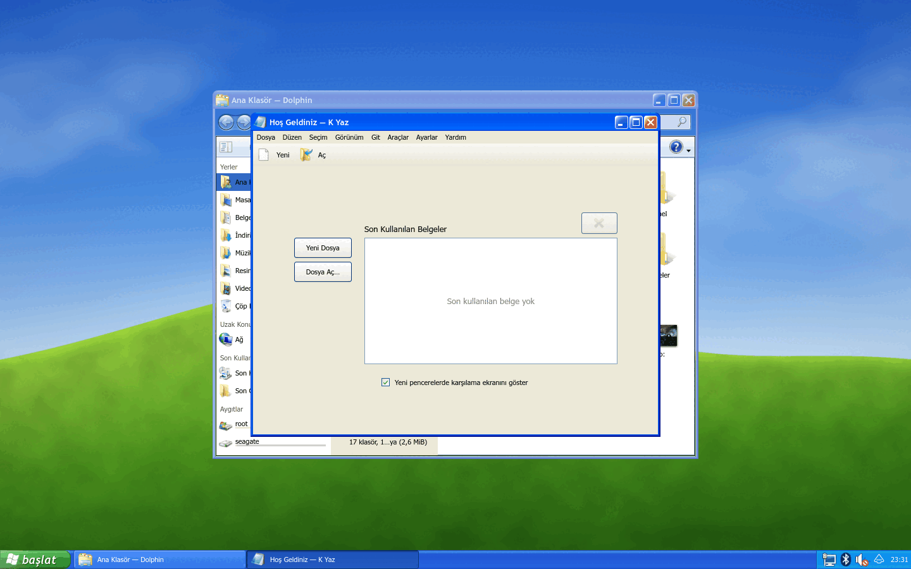
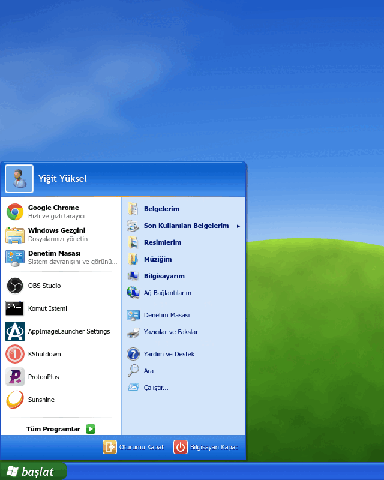
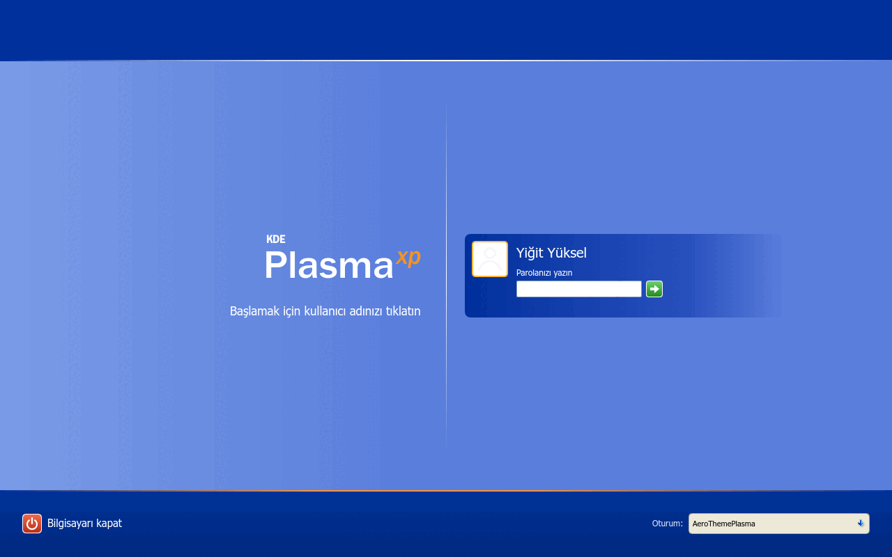
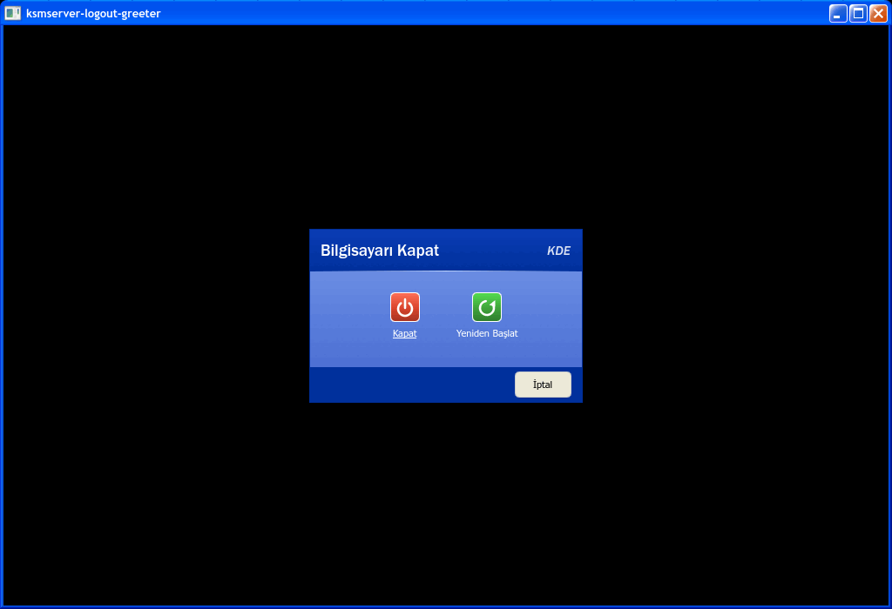

# XPThemePlasma

KDE Plasma 6 için **Windows XP Luna (Mavi)** görünümü. [AeroThemePlasma](https://gitgud.io/wackyideas/aerothemeplasma)'nın
Windows 7 için yaptığını, Windows XP için yapar ve ATP ile **yan yana** çalışır: SDDM'de
"XPThemePlasma (Wayland)" oturumunu seçersin, çıkınca ATP olduğu gibi geri gelir.



| Başlat menüsü | Hoş geldiniz (SDDM) | Bilgisayarı Kapat |
|---|---|---|
|  |  |  |

İki kipte çalışır:

* **Çizim kipi** (varsayılan): depoda hiçbir Microsoft dosyası yoktur; görseller `tools/` altındaki
  Python betikleriyle Luna paletine göre sıfırdan çizilir.
* **Gerçek XP kipi**: kendi Windows XP kopyan varsa (ISO, CD'nin `I386` klasörü ya da bir XP
  kurulumunun `WINDOWS` klasörü) `bash kur.sh --xp <yol>` her şeyi oradan alır — XP'yi kurmuşsun gibi:

  | | Kaynak |
  |---|---|
  | Pencere çerçevesi, düğmeler, kaydırma çubukları, sekmeler… | `luna.msstyles` bitmap'leri (msstyles ayrıştırıcı) |
  | Görev çubuğu, tepsi, "Başlat" düğmesi, Başlat paneli | `luna.msstyles` + `explorer.exe` (Türkçe XP'de "Başlat") |
  | Windows XP simge teması (~300 ad) | `shell32.dll`, `explorer.exe`, `netshell.dll`, `*.cpl`, uygulama `.exe`'leri |
  | İmleçler (XP işaretçi gölgesiyle) | `user32.dll` |
  | Ses düzeni (açılış, kapanış, hata, aygıt takma…) | `xp*.wav` |
  | Bliss ve diğer 19 duvar kağıdı | `I386\*.jpg` |
  | Açılış ekranı (kayan mavi bloklar) | `ntoskrnl.exe` (kaynakta siyah tutulan palet yeniden kuruldu) |
  | Hoş geldiniz ekranı | `logonui.exe` |
  | Komut İstemi: Terminal raster yazı tipi, XP açılış metni | `vga857.fon`, `cmd.exe` ileti tablosu |

  Bu dosyalar `~/.local/share/xpthemeplasma/xp` altına çıkarılır, depoya girmez.

## İçerik

| Bileşen | Ne yapar | Kaynak |
|---|---|---|
| **XP-Luna** (Aurorae) | Mavi yuvarlak köşeli başlık çubuğu, turuncu kapat / mavi küçült-büyüt düğmeleri | `tools/gen_aurorae.py` |
| **XPLuna** (Kvantum) | Uygulama içleri: XP düğmeleri (turuncu üzerine gelme halkası), yeşil onay işaretleri, mavi kaydırma çubukları, yeşil bloklu ilerleme çubuğu, turuncu çizgili sekmeler, beyaz menüler | `tools/gen_kvantum.py` |
| **XP-Luna** (Plasma teması) | Mavi görev çubuğu, XP görev düğmeleri, sarı araç ipuçları, açılır pencereler | `tools/gen_desktoptheme.py` |
| **XP Başlat** (plasmoid) | Yeşil "başlat" düğmesi; iki sütunlu menü (kullanıcı resmi, sabitlenenler + sık kullanılanlar, Belgelerim / Bilgisayarım / Denetim Masası…, Oturumu Kapat / Bilgisayarı Kapat). "Tüm Programlar" gerçek kademeli menüler açar | `plasma/plasmoids/io.github.yyozcan.xpstart` |
| **XP Paneli** (kapsayıcı) | ATP panelinin çatalı: bildirim alanının arkasına XP'nin açık mavi tepsisini çizer, panel yazılarını beyaz yapar | `plasma/plasmoids/io.github.yyozcan.xppanel` |
| **XP Kabuğu** + yerleşim | İlk açılışta: başlat · görevler · tepsi · saat (Tahoma 8) | `plasma/shells`, `plasma/layout-templates` |
| **XP Luna** (Görünüm ve His) | XP açılış ekranı (siyah zemin, kayan üç mavi blok) | `plasma/look-and-feel` |
| **Bilgisayarı Kapat** | XP'nin Bekleme / Kapat / Yeniden Başlat ve Kullanıcı Değiştir / Oturumu Kapat pencereleri (gerçek kipte `msgina.dll` ve `shell32.dll` bitmap'leri, sarı balon ipuçları, ÜstKrkt ile Hazırda Beklet); arkada masaüstü yavaşça griye döner; seçimden sonra "Ayarlarınız kaydediliyor…" / "Windows kapatılıyor…" ekranı ve XP kapanış sesi | `plasma/shells/…/contents/logout`, `kwin/effects/xp_gri` |
| **Hoş geldiniz** (SDDM) | XP karşılama ekranı: kullanıcı kutucukları, yeşil ok, Bilgisayarı kapat, oturum seçici | `sddm/xpthemeplasma` |
| **Tepe** duvar kağıdı | Bliss'ten esinlenmiş, prosedürel yeşil tepe + mavi gök | `tools/gen_wallpaper.py` |
| **XPLuna** renk şeması | `#ECE9D8` yüzey, `#316AC5` seçim | `plasma/color_scheme` |
| **Windows Gezgini** | XP Gezgini: Döşemeler/Simgeler/Liste/Ayrıntılar, görev bölmesi (Dosya ve Klasör Görevleri, Diğer Yerler, Ayrıntılar), Klasörler ağacı, Bilgisayarım; XP oturumunda klasörlerin varsayılanı | `apps/gezgin` |
| **Denetim Masası** | XP Kategori ve Klasik Görünüm; her simge ilgili KDE ayar modülünü kendi penceresinde açar | `apps/denetim` |
| **Ses Düzeyi** | Tepsideki XP ses penceresi: "Ses Düzeyi", XP kaydırıcısı, "Sessiz"; tekerlekle ses, orta tıkla sessiz | `plasma/plasmoids/io.github.yyozcan.xpses` |
| **Bildirim balonları** | Bildirimler XP'nin sarı tepsi balonları olarak (kuyruk, XP kapatma düğmesi, balon sesi) | `plasma/plasmoids/io.github.yyozcan.xpbalon` |
| **Hoş Geldiniz** | Oturum açılınca masaüstü yüklenirken XP'nin "Hoş Geldiniz" ekranı | `look-and-feel/.../splash` |
| **Plymouth** | Bilgisayar açılırken XP açılış ekranı ve kayan mavi bloklar (en az 10 sn; simpledrm'den başlar, NVIDIA/AMD sürücüsüne geçince yeniden yerleşir); kapanış/yeniden başlatmada "Windows kapatılıyor…" (`sudo bash kur.sh --plymouth`, geri: `--plymouth-geri`) | `plymouth/` |
| **Oturum sesleri** | Hoş Geldiniz ekranı kapanınca "Windows XP Başlangıç" (açılıştan sonraki ilk girişte) ya da "Oturum Açma"; Oturumu Kapat'ta XP oturum kapatma, Kapat'ta XP kapanış sesi | `session/xp-giris-sesi`, `logout` |
| **Görev Yöneticisi** | Uygulamalar / İşlemler / Performans (yeşil CPU ve SD göstergeleri, geçmiş grafikleri) / Ağ İletişimi / Kullanıcılar; öncelik ve benzeşim, işlem ağacını sonlandırma; bildirim alanında CPU göstergesi. Ctrl+Shift+Esc ve Ctrl+Alt+Del | `apps/gorev` |
| **Çalıştır** | XP Çalıştır penceresi (Windows+R): `cmd`, `notepad`, `calc`, `control`, `taskmgr`, `sysdm.cpl`, `desk.cpl`, `%USERPROFILE%`, URL'ler… | `apps/calistir`, `apps/ortak/xpkomut.h` |
| **Sistem Özellikleri** | Genel (bu bilgisayarın dağıtımı, çekirdeği, işlemcisi, belleği; dağıtım logosu "Üreten ve destekleyen"), Bilgisayar Adı, Donanım, Gelişmiş. Windows+Pause | `apps/sistem` |
| **Tarih ve Saat Özellikleri** | Takvim, analog saat, XP saat dilimi haritası, Internet Saati (timedatectl / timesyncd) | `apps/tarihsaat` |
| **Görüntü Özellikleri** | Temalar, Masaüstü (duvar kağıdı, konum, renk), Ekran Koruyucu (ekran kilidi), Görünüm (yazı tipi boyutu), Ayarlar (çözünürlük) | `apps/gorunum` |
| **Windows Hakkında** | `winver` ve programların Hakkında kutusu: XP şeridi, sürüm, kullanıcı, bellek | `apps/hakkinda` |
| **Gerçek XP programları** | Kendi XP kopyandaki Hesap Makinesi, Paint, WordPad, Karakter Eşlem, Ses Kaydedicisi, Mayın Tarlası, Solitaire, FreeCell, Hearts, Örümcek Solitaire ve 3D Pinball, Wine ile ve Luna temasıyla (ayrı ön ek: `~/.local/share/xpthemeplasma/wine`) | `session/xp-wine` |
| **XP kısayolları** | XP oturumunda: Ctrl+Alt+Del / Ctrl+Shift+Esc Görev Yöneticisi, Windows+R Çalıştır, Windows+E Gezgin, Windows+Pause Sistem, Print Screen ekranı sessizce panoya | `session/xp-profil` |
| **Tüm Programlar** | XP düzeni: Donatılar (Erişilebilirlik, Eğlence, İletişim, Sistem Araçları), Başlangıç, Oyunlar; uygulamalar XP adlarıyla (Not Defteri, Paint, Hesap Makinesi, Internet Explorer, Windows Media Player…) | `xpstart/.../code/xpdizin.js` |
| **Not Defteri** | XP Not Defteri'nin menüleri ve iletileriyle Qt metin düzenleyici (yalnızca XP oturumunda görünür, `.txt` varsayılanı) | `apps/notdefteri` |
| **XP Alt+Tab** | CoolSwitch: 3B yüzey, simge ızgarası, çökük başlık kutusu | `kwin/tabbox/xp_alttab` |
| **XP Komut İstemi** | Konsole profili: Terminal raster yazı tipi, 80×25, `C:\Documents and Settings\…>` istemi | `session/konsole` |
| Yazı tipi işleme | XP oturumunda küçük Tahoma kenar yumuşatmasız (XP "Standart" yumuşatma) | `session/xp-fonts.conf` |
| Animasyonlar | XP oturumunda pencere solması kapalı; menü solması, küçültme/büyütme açık | `session/xp-profil` |
| Türkçe | Başlat, Tüm Programlar, Belgelerim, Bilgisayarım, Denetim Masası… (XP'nin Türkçe terimleri) | `po/tr` |

## Kurulum

```bash
bash kur.sh                    # görselleri üretir, ~/.local ve ~/.config altına kurar (sudo gerekmez)
bash kur.sh --xp "/yol/Windows XP.iso"   # (isteğe bağlı) kendi XP kopyandan gerçek varlıklar
sudo bash kur.sh --sistem      # SDDM oturum girdisi, /usr/local/bin/startxp-wayland, XP karşılama teması
sudo bash kur.sh --sddm-xp     # (isteğe bağlı) SDDM'de XP karşılama ekranını etkinleştir
```

Sonra oturumu kapat, SDDM'de **XPThemePlasma (Wayland)** seç.

XP sistem programlarının pencere düzenleri ve metinleri kurulumda kendi XP kopyandan (`taskmgr.exe`, `sysdm.cpl`,
`timedate.cpl`, `themeui.dll`, `shell32.dll`… iletişim kutusu kaynakları) çıkarılır (`tools/gen_luna_dlg.py`) ve
`apps/ortak/xpdlg.h` bunları Qt ile birebir kurar; depoya Microsoft metni ya da görseli girmez.

Gerekenler: Plasma 6.8, `kvantum`, `python3` + `python-pillow` + `python-numpy`, `rsvg-convert` (librsvg), `msgfmt` (gettext),
isteğe bağlı `wine` (gerçek XP programları),
Tahoma / Trebuchet MS / Franklin Gothic yazı tipleri (ör. `ttf-ms-win11-auto`).

## ATP ile birlikte nasıl çalışır?

KDE ayarları (`kdeglobals`, `kwinrc`, `plasmarc`…) iki oturumda ortaktır. Bu yüzden:

* `~/.config/plasma-workspace/env/xpthemeplasma.sh` her Plasma oturumunun başında çalışır.
* XP oturumunda `xp-profil xp`: yönetilen tema anahtarlarının (renk şeması, Kvantum teması, pencere çerçevesi,
  Plasma teması, yazı tipleri, ATP'nin cam/parıltı efektleri…) mevcut değerlerini
  `~/.local/state/xpthemeplasma/onceki.json`'a kaydeder ve XP değerlerini yazar.
* XP'den çıkınca (ya da XP oturumu çökse bile bir sonraki ATP girişinde) `xp-profil geri`: XP ayarlarını
  `xp.json`'a saklar, önceki değerleri birebir geri yükler.
* Panel düzeni ayrıdır: XP kabuğu kendi `plasma-io.github.yyozcan.xpshell-appletsrc` dosyasını kullanır.
* XP oturumu ATP'nin `/etc/xdg/aerothemeplasma` katmanı yerine `~/.local/share/xpthemeplasma/xdg` katmanını kullanır
  (simge teması korunur, oturum kapatma onayı açıktır, "Bu Sistem Hakkında" XPThemePlasma der).
* Başlat menüsünün sabitlenenleri KDE'de tüm başlatıcılar arasında **ortaktır** (ATP'nin SevenStart'ı dahil);
  XP Başlat bu ortak listeye kendiliğinden hiçbir şey yazmaz.

Elle: `xp-profil durum`, `xp-profil geri`.

## Kaldırma

```bash
bash kur.sh --kaldir
sudo rm /usr/local/bin/startxp-wayland /usr/share/wayland-sessions/xpthemeplasma.desktop
```

## Geliştirme

`tools/luna.py` ortak çekirdek: SVG çizer → `rsvg-convert` ile rasterlar → 9 parçaya böler → Kvantum / Plasma /
Aurorae'nin beklediği eleman kimlikleriyle tek SVG'ye gömer (2x çözünürlük, HiDPI'da da keskin).
Renkleri değiştirmek için `luna.py` içindeki degrade listelerini düzenleyip `bash kur.sh` çalıştırmak yeter.

## Lisans

GPL-3.0-or-later. Çatallanan parçalar (XP Paneli ← ATP/KDE paneli, ActionMenu/tools.js ← Kicker/SevenStart)
kendi GPL-2.0-or-later başlıklarını korur.
